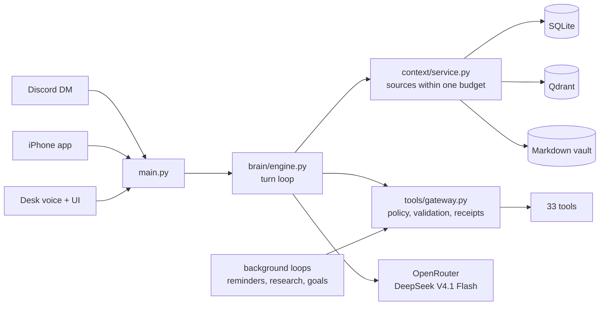

# JARVIS

[](https://github.com/haytham2872/jarvis-assistant/actions/workflows/tests.yml)
[](LICENSE)

A personal AI assistant you host yourself. It lives on a small server, you talk to it in a
private Discord DM (or an iPhone app, or at your desk by voice), and it works for one person:
you. It remembers, keeps a schedule, does research while you sleep, and asks before anything
that leaves your hands.

One OpenRouter key and a Discord bot are enough to start. Normal use costs cents a day.
**[Set it up →](docs/SETUP.md)**

## What it does

- **Remembers.** Every exchange is stored in full; facts, notes, a portrait of you and
  letters it writes to its future self build up over time in an Obsidian-compatible vault.
  Recall is hybrid (dense + BM25), checked by a local cross-encoder before it reaches a turn.
- **Acts at a time.** Reminders, tasks that look something up at a set time ("the price at
  the market open, every weekday"), night tasks, a morning brief, and watches that message
  you when a condition becomes true.
- **Works in the background.** Research jobs, cited reports, and long-running goals with
  milestones, a budget and saved evidence, while the conversation goes on.
- **Plans your week.** Reads and edits your Google Calendar, places blocks around your
  meetings, checks in each evening on how they went, and reschedules what slipped.
- **Keeps track of what you hold.** A portfolio ledger with exact arithmetic, dated closes,
  split detection, and theses with conditions it checks itself.
- **Learns procedures.** Recurring tasks become skills (in the open Agent Skills format) that
  you can correct in one sentence.
- **Hears and reads.** Voice notes in English and French, transcribed locally; images and
  documents (PDF, Word, Excel, scans) in any message.

33 tools in all: web search and research, Gmail, Calendar, Notion, Spotify, the vault,
memory, scheduling, watches, forecasts, goals, people profiles and more. It has no shell and
cannot touch your screen.

## Built to be trusted

An assistant with your email and calendar has to be right about what it did.

- **Outward actions are gated in code, not in the prompt.** Sending email or changing someone
  else's calendar needs your words in the current message, or a tap on an approval request.
  Background work can never send anything on its own.
- **Claims are checked against what ran.** A reply that says something was saved, scheduled
  or sent is checked against the tool calls before it goes out.
- **Tool results outlive the turn.** Every call leaves a receipt; later turns see what tools
  actually returned, so the assistant neither invents nor retracts what happened.
- **Web pages and emails are data.** They are marked as untrusted text, and instructions
  inside them are named, not followed.
- **Everything is durable.** Conversations, jobs, approvals and deliveries live in SQLite; a
  restart resumes or reports what was cut off and never repeats an uncertain send.

## Architecture



- **Python 3.12, FastAPI, asyncio.** One process; paced background loops run beside the
  conversation.
- **OpenRouter** for every model call: one model with reasoning off for simple turns and on
  for hard ones, chosen per message by a fast classifier.
- **SQLite** for canonical state, **Qdrant** for semantic search, **Markdown** files for
  everything you might want to read or edit yourself.
- **Electron + React + Three.js** desk interface, **Expo / React Native** phone app.

## Engineering

The [engineering log](docs/engineering-log.md) has twelve real problems from building it,
each reproduced before it was fixed. A few of the numbers:

- Memory recall from **6.4 s to 0.26 s** once a two-second IPv6 connection stall was found.
- Prompt-cache hit rate from **36% to 81%**, cutting a conversation's cost by 62%, by moving
  one block of text.
- Median reasoning turn from **43 s to 11 s** by choosing the model host by speed, not price.
- False retractions of true tool results from **1 in 9 to 0 in 9** with a code-written record.

The test suite has about 4,400 tests and needs no model, key or database. Changes are
mutation-tested: a deliberate bug is introduced and a test must fail.

## Running it

| | |
|---|---|
| Server (Linux, always on) | [docs/SETUP.md](docs/SETUP.md), then [DEPLOY.md](DEPLOY.md) |
| Windows desk (voice, UI) | [RUNNING.md](RUNNING.md) |
| Tests | `pip install -r requirements.txt && python -m pytest backend` |

## Repository

```
backend/brain/      conversation engine, memory, scheduling, research, goals, skills
backend/tools/      tool registry, gateway and action policy
backend/storage/    SQLite stores
backend/context/    what reaches each turn, within one budget
backend/mobile/     the phone app's API
frontend/           Electron desk UI
mobile/             Expo iPhone app
docs/               setup, the assistant's self-model, the engineering log
```

## License

[MIT](LICENSE).
